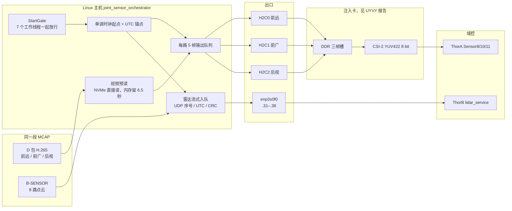

# 视频与点云联合发布：当前架构、进度与后续

> 核对日期：2026-11-13  
> 上位机：`joint_sensor_player` / `joint_sensor_orchestrator`  
> 数据：`1_00062_20261021-101724`，共同窗口约 40 秒  
> 本文只记录已经在这台机器上跑过的事。没跑过的项保持未验证，不写成已通过。

两篇已有文档继续有效，本文不重复它们的细节：

- 台架目标和拆分：[自研台架规划](https://hellobike.yuque.com/lf77a5/project_doc/yz0gmg6fvqqygqd4)
- 注入卡三路 UYVY 合同：[PCIe → DDR → MIPI 三路 UYVY422 注入全流程报告](https://hellobike.yuque.com/lf77a5/project_doc/qua87hy5sbnkn6m5)

注入卡侧的 PCIe Gen3 x4、三路 H2C、DDR 三帧槽、CSI-2 `DT=0x1E`、ThorA Sensor8/10/11 约 30 fps，仍以第二篇的实测为准。本文回答的是上一层：同一条命令怎么把 3 路视频和 8 路点云按同一条时间轴发出去，以及整段约 40 秒现在卡在哪里。

## 0. 当前结论

一条命令可以同时做两件事：

- 三路解码后的 UYVY 经 `/dev/xdma0_h2c_0..2` 推进注入卡，物理输出仍是 30 Hz；
- 八路雷达 UDP 从 `enp3s0f0` 的 `192.168.1.31–.38:10000` 发往域控 `192.168.1.4`。

10 秒联合播放已经稳定跑通：点云整段放在内存盘，视频窗口先拷进 `/dev/shm` 再按截止时间写卡。视频迟到门限 5 毫秒，雷达迟到门限 100 毫秒，都没有放宽。

整段约 40 秒不能再把视频拷进内存。三路解码后的 UYVY 大约 31 GiB，本机 `/dev/shm` 只有 15.5 GiB。当前做法是视频留在 NVMe，内存里只保留大约 6.5 秒的滑动预读，点云仍整段放在 `/dev/shm`。

2026-11-13 在接好的注入卡上实测：开播后大约 35 秒内，每帧迟到约 0.06 毫秒。最后两三秒，每一帧写卡比 33.333 毫秒长大约 0.05 毫秒，迟到往上加，到 38–39 秒越过 5 毫秒门限停掉。完整 40 秒还没有一次 `ok: true`。

还不能宣称的事：

- 雷视硬件同步、FSYNC、双卡七路，都还是未跑；
- 生产 `camera_service` 没有改，验收仍走独立预览 `img_transfer_v2`；
- 四路环视还没有解码，也没有发送。

## 1. 联合发布架构

一个进程里同时跑雷达和视频。不把两个播放器在外面拼起来，是因为两个进程对不齐同一个起点，也停不齐。



工作线程固定 7 个：1 个雷达，3 路视频各一个生产者和一个消费者。预读线程不占这 7 个名额，它在倒计时和回车等待期间就可以读盘。7 个线程都到达 StartGate 之后，才开始 5 秒倒计时；回车之后再用 5 秒把发送队列预填满，然后打印 `发送开始`。倒计时和回车都不算进发送时长。

视频和雷达共用同一个单调时钟起点。截止时间是：

```text
相对时间 = 源时间戳 - 共同窗口起点
截止时间 = 单调时钟播放起点 + 相对时间
对外 UTC = UTC 锚点 + 相对时间
```

调度用 `CLOCK_MONOTONIC`。UTC 只写进雷达包，用来给域控看。系统时间跳变不会改已经算好的截止时间。

## 2. 三路视频怎么对齐到 30 Hz

注入卡和 ThorA 的物理链路是 30 Hz，这是第二篇文档里的合同，联合播放器没有改它。

| 通道 | 相机 | 源帧率 | 输出 | H2C | 域控 |
| --- | --- | --- | --- | --- | --- |
| tx1 | 前远 | 10 Hz | 每帧重复 3 次，30 Hz | 0 | Sensor8 |
| tx2 | 前广 | 30 Hz | 一帧一个槽 | 1 | Sensor10 |
| tx4 | 后视 | 10 Hz | 每帧重复 3 次，30 Hz | 2 | Sensor11 |

重复输出的三帧共用同一块内存，报告里仍记成同一个源帧。源帧时间戳和输出槽时间戳分开记，不能把重复帧当成新的采集帧。

一帧 4K UYVY 是 `3840 × 2160 × 2 = 16,588,800` 字节。三路都以 30 Hz 写出时，注入卡入口大约 1.49 GB/s。10 Hz 那两路因为重复，磁盘只需要读源帧：前广约 498 MB/s，前远和后视各约 166 MB/s，三路合计约 830 MB/s。盘必须稳定高于这个数，5 毫秒门限才守得住。

## 3. 点云怎么和视频用同一条时间轴

八路点云仍走原来的雷达发送，没有另写一套协议：

- 主前 / 主左 / 主右 / 主后：`.31–.34`
- 补前 / 补左 / 补右 / 补后：`.35–.38`
- 目的地址：`192.168.1.4`
- PTC 标定：本机 TCP `9347`，按各路 correction 文件应答

整段点云大约 1.1 GiB，联合播放前钉在 `/dev/shm/joint_radar_data`，避免播放中途被换出。播放器不改 MCAP。`continuous` 只改内存发送副本里的 UDP 序号，包内点云内容和采集时间戳保持原样；对外 UTC、微秒时间和主雷达 CRC 按现有真雷达模拟器的规则重写，让域控能按连续时间解包。

雷达按截止时间出队。视频写卡如果长时间占住 CPU 或内存带宽，雷达包会一起晚。所以视频读盘必须让出 CPU，不能一次把 16 MB 读完还占着核。

## 4. 数据放在哪

本机内存 31 GiB，`/dev/shm` 是内存盘，上限约 15.5 GiB。加大 swap 不会把这个上限变大。换出去的视频页再换回来，赶不上 5 毫秒。

| 数据 | 大约体积 | 现在放哪 |
| --- | --- | --- |
| 三路整段 UYVY | 31 GiB | NVMe 缓存目录，不进内存盘 |
| 点云整段 | 1.1 GiB | `/dev/shm`，并锁定 |
| 10 秒播放用的视频窗口 | 约 8.5 GiB | 仍整段拷进 `/dev/shm`，这条路径没改 |
| 40 秒播放的视频预读 | 6.5 秒约 5.4 GiB | 内存里的滑动窗口 |
| 七路如果都按 4K×30 Hz 物化 40 秒 | 约 139 GiB | 放不进这台机器 |

10 秒配置 `orchestrator_xdma_joint_10s_shm.yaml` 行为不变：`video_prefetch_ms` 为 0 时，仍把播放窗口 stage 到 `/dev/shm`。40 秒配置才打开预读。

预读窗口不能再加大到把开播后的内存申请也算进去。12 秒窗口大约 10 GiB，倒计时结束时还没读完，注入卡已经开始写，后面的页申请会把读盘卡住，6 秒左右就迟到。6.5 秒是开播前能读满的上限附近。

解码缓存已经在 NVMe 上，扩展 10 秒到 40 秒不用再解码一遍。四路环视是 1920×1200、10 Hz，以后按原分辨率解码，大约再加 6.9 GiB，不把它们放大成 4K。

## 5. 40 秒路径上的难点

### 5.1 不能整段进内存

7 路里现在只用 3 路。这 3 路解码后已经约 31 GiB。点云再加 1.1 GiB。31 GiB 内存装不下，swap 也不能当热数据，因为 5 毫秒门限不允许缺页。注入卡上的 DDR 是帧槽，不是磁盘，不能把 40 秒素材留在卡上。

### 5.2 普通读盘不够快，还会把内存挤掉

一开始按 1 MB 普通读，并且读完就丢掉页缓存。单读前广只有大约 400 MB/s，三路需要大约 830 MB/s。同一块盘用直接读可以到大约 2 GB/s。直接读不经过页缓存，不会把 31 GiB 文件留在内存里把预读窗口换出去。

每次启动如果把 31 GiB 再算一遍 SHA-256，普通读大约要两分钟，而且会先把文件灌进页缓存。文件大小和修改时间没变时，现在跳过这次重算。文件改过仍会重算。

### 5.3 预读不能只服务最早的那一路

三路源时间戳只差几十毫秒。如果填充线程永远先补时间最早的那一路，那一路窗口满了就去睡，30 Hz 的前广会只剩当场读。当场读一帧要十几到三十毫秒，输出槽只有 33.333 毫秒，5 毫秒门限没有余量。

现在按「下一帧还没进内存、而且时间更早」来选路。10 Hz 的前远、后视和 30 Hz 的前广一起补。倒计时加回车后的 5 秒预热，用来在开播前把 6.5 秒窗口读满。开播后只补窗口滑出去的新帧，不再整段申请内存。

前广是唯一一路每个输出帧都要读新数据，所以它最先暴露读盘不够快。前远和后视每三帧才读一次。

### 5.4 写卡时间会累加

截止时间是绝对时间，间隔严格 33.333 毫秒。某一帧如果写卡加上调度超过这个间隔，下一帧醒来时已经晚了，晚的时间会一帧一帧加上去。

2026-11-13 的记录里，前 35 秒帧间隔就是 33.333 毫秒，迟到约 0.06 毫秒。最后约 90 帧的平均间隔变成大约 33.39 毫秒。大约 0.05 毫秒一帧，几十帧之后越过 5 毫秒。把预读从 5 秒加到 6.5 秒，没有把这个尾巴推过 40 秒。所以剩下的问题主要在写卡和调度，不只是盘还没读进来。

雷达门限是 100 毫秒。整帧 16 MB 一次读完时，见过雷达迟到 100.022 毫秒，只过线 22 微秒。所以直接读改成 1 MB 一块，块与块之间让出 CPU。视频门限和雷达门限都没有放宽。

### 5.5 和注入卡之间的边界

主机只负责把完整的 16,588,800 字节点进 H2C。首拍缓存、行边界、DDR 三帧槽、EBD、CSI-2 和 GMSL 都在注入卡里，合同仍是第二篇文档。主机侧短包、非完整帧不能拿来当成功。

网页预览大约 10 fps 是 `img_transfer_v2` 故意限频。底层注入和 ICP 仍按 30 Hz 设计。不能用网页 FPS 判断联合播放有没有丢帧。

## 6. 2026-11-13 实测

配置：`config/orchestrator_xdma_joint_40s.yaml`  
命令：

```bash
cd ~/zhang/joint_sensor_player
./build-release/joint_sensor_orchestrator \
  --config config/orchestrator_xdma_joint_40s.yaml
```

`play_duration_ms: 0` 表示播完共同窗口，不提前按墙钟截断。`wait_for_enter: true`。倒计时里按过的回车不算，看到「等待回车」后再按一次。

同一天在这台已经接好的设备上，40 秒配置的几次结果：

| 发送时长 | 停在哪 | 说明 |
| --- | --- | --- |
| 5.6 秒 | 前广视频迟到 | 1 MB 普通读，前广几乎没有预读 |
| 23 秒 | 前广视频迟到 | 改成直接读之后，前 21 秒帧间隔仍是 33.333 毫秒，然后断了一截 |
| 39.1 秒 | 前远视频迟到 | 三路都在补，但前广窗口经常是空的，靠当场读撑住 |
| 12.1 秒 | 后视视频迟到 | 12 秒窗口太大，开播后还在申请内存，后视还没读到 |
| 8.1 秒 | 雷达迟到 100.022 毫秒 | 视频窗口当时是满的；整帧读把雷达顶过 100 毫秒 |
| 38.1 秒、39.1 秒、38.1 秒 | 前远或前广视频迟到 | 1 MB 直接读并让出 CPU 之后，稳定停在最后 1–2 秒 |

10 秒内存盘路径没有在这一轮里重跑。它之前的结论不变：联合 10 秒可以过，视频 5 毫秒、雷达 100 毫秒。40 秒这一轮没有把 10 秒改退。

报告在 `reports/orchestrator-20261113-*`。失败时看 `summary.json` 的 `stop_reason`。抛出门限的那一帧不会写进 `video_frames.csv`，要用 `play_start_ns` 和最后一条 `actual_write_ns` 看空洞。`physical_sync` 和 `hardware_fsync` 在这些报告里仍是 `NOT_RUN`。

## 7. 后面怎么做

按依赖排，不把没跑的写成下一步已经有了。

1. **把约 40 秒跑完，门限不动。**  
   前 35 秒已经在门限内。要查的是最后几秒为什么写卡从 33.333 毫秒变成大约 33.39 毫秒。优先看三路 H2C 写是否在末尾变慢，以及预读线程是不是又和写卡抢同一段时间。不把 5 毫秒改成更大的数来换一次通过。

2. **10 秒路径保持可回归。**  
   `orchestrator_xdma_joint_10s_shm.yaml` 继续整段进 `/dev/shm`。40 秒的预读只在 `video_prefetch_ms > 0` 时生效。

3. **域控侧只做核对，不改生产服务。**  
   相机看 ThorA 的 `img_transfer_v2`，Sensor8/10/11。雷达看 ThorB 的 `lidar_service`。生产 `camera_service` 仍不作为这条链路的验收对象。八路点云是否在融合里都是 10 Hz，以域控日志为准，不能用主机 ping `192.168.1.31–.38` 判断。这台机器的模拟网口占用这些地址时，域控看到的是主机，不是车上的雷达。

4. **七路放到第二张卡之后。**  
   现在这一张卡只有 3 个 H2C。环视四路按 1920×1200 原分辨率解码，大约 6.9 GiB，盘上放得下。七路同时 30 Hz 写出之前，要重新算 PCIe、DDR 和主机读盘。不能把第二篇里的三路通过，写成七路已经通过。

5. **硬件同步仍单独立项。**  
   现在是内容时间轴一致：同一段 MCAP、同一个起点、10 Hz 源重复到 30 Hz。没有 MAX96717 的 FSYNC，也没有把雷视 `physical_sync` 记成通过。

## 8. 复现时看什么

开播前：

```bash
cd ~/zhang/joint_sensor_player
./scripts/prepare_network.sh --check
./scripts/check_xdma_conflicts.sh
```

通过时报告里应同时满足：

- `summary.json` 的 `ok` 为 true；
- `stop_reason` 是正常播完，不是「视频迟到」或「雷达迟到」；
- 发送时长接近共同窗口，约 40 秒，而不是提前停；
- `run.log` 里 `video_prefetch_ms=6500` 且 `staged_bytes=0`；
- 视频每帧迟到低于 5 毫秒，雷达低于 100 毫秒；
- `physical_sync`、`hardware_fsync` 仍是 `NOT_RUN`，除非另有 FSYNC 和域控对齐证据。

10 秒回归仍用：

```bash
./build-release/joint_sensor_orchestrator \
  --config config/orchestrator_xdma_joint_10s_shm.yaml
```

这条成功时 `staged_bytes` 应约为 9.1 GB，而不是 0。
